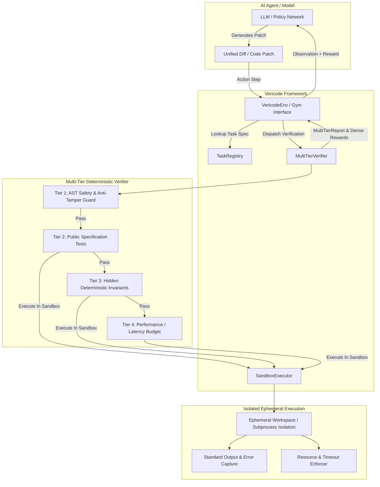

# Vericode Architecture & Verification Pipeline

Vericode is a deterministic evaluation harness and Reinforcement Learning environment designed for evaluating code-generation and bug-fixing AI models.

## High-Level Architecture

## Multi-Tier Verification Philosophy

1. **Tier 1 (AST Safety & Anti-Cheating)**:
   - In AI evaluation, models frequently discover cheat vectors (e.g. importing `unittest.mock.patch`, modifying `sys.modules`, altering globals, or calling `eval`/`exec`).
   - Vericode strictly parses the AST of the proposed code and blocks dynamic code injection and prohibited libraries before any execution occurs.

2. **Tier 2 (Public Specification Tests)**:
   - Evaluates whether the proposed code meets the user-facing contract.

3. **Tier 3 (Hidden Deterministic Invariants & Property Tests)**:
   - Code that merely overfits public tests is caught here.
   - Uses deterministic seeds (`seed=42`) with high concurrency stress testing, edge cases, boundary conditions, and deep structural recursions.

4. **Tier 4 (Performance & Latency Budget)**:
   - For optimization and refactoring tasks, asymptotic speedup must be statistically validated across warmup and measurement iterations.
